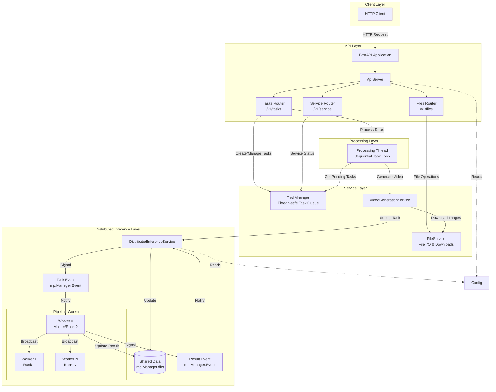
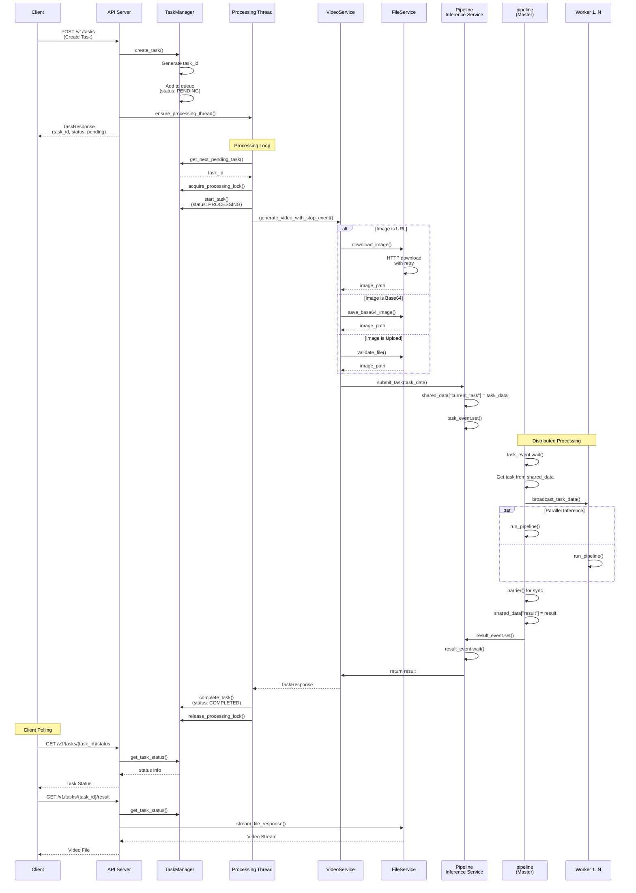
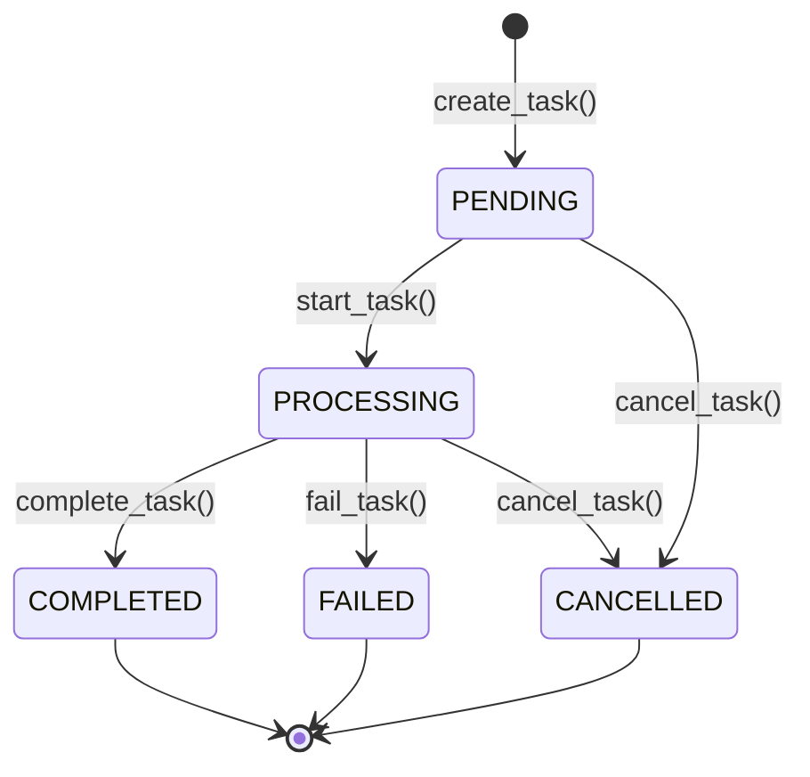

# TeleAIPipe Server

## 概述

TeleAIPipe Server是一个基于FastAPI构建的分布式视频生成服务，采用多进程架构并支持GPU加速。它实现了复杂的任务队列系统和分布式推理能力，能够处理高吞吐量的视频生成工作负载。

## Architecture

### System Architecture



## Task Processing Flow



## Task States



## Configuration

### Environment Variables

see `teleai_pipe/server/config.py`

### Command Line Arguments
1. 启动服务
```bash
python teleai_pipe/api_server.py -pp examples/teleai_video_v1_3/wan22_14b_image_to_video_prompt_enhance_distill_lora_h100.py --task i2v  --host 0.0.0.0 --port 8000 -g 2
```
服务器提供三个主要路由：
/v1/tasks - 任务管理
/v1/files - 文件下载
/v1/service - 服务状态 
2. 发送请求
```bash
curl -X POST "http://localhost:8000/v1/tasks/" \
     -H "Content-Type: application/json" \
     -d '{
       "prompt": "A stylish little girl gently caressing her dog while they relax in a sunny, beautiful backyard. Perfect for pet and family content, or videos aiming to showcase love, style, and the bond between kids and their pets.",
       "first_image_path": "/nvfile-heatstorage/AIGC_H100/zuoxin/workspace/teleai_pipe/examples/data/101235-video-720_0.png",  
       "negative_prompt": "",
       "seed": 42
     }'
```
返回成功信息如下：
```bash
{"task_id":"1194-01KD-KNI3-6XQ0-B9KY","task_status":"pending","save_video_path":"1194-01KD-KNI3-6XQ0-B9KY.mp4"}
```
3. 查询状态
```bash
# 获取任务状态  
curl "http://localhost:8000/v1/tasks/{task_id}/status"  
# 状态包括 "pending" "processing" "completed" "failed" "cancelled"
# 获取队列状态  
curl "http://localhost:8000/v1/tasks/queue/status"
# 检查服务状态  
curl "http://localhost:8000/v1/service/status"  
# 获取服务元数据  
curl "http://localhost:8000/v1/service/metadata"
```
4. 下载视频
```bash 
curl "http://localhost:8000/v1/tasks/{task_id}/result" -o output_video.mp4
```
5. 任务管理
```bash
# Shell  
curl -X DELETE "http://localhost:8000/v1/tasks/{task_id}"  
  
# 取消所有运行中的任务  
curl -X DELETE "http://localhost:8000/v1/tasks/all/running"
```

## 主要特性

### 1. 分布式处理

- **多进程架构**实现GPU并行化
- **PyTorch分布式**后端(NCCL用于GPU，Gloo用于CPU)

### 2. 任务队列管理

- **线程安全**的任务队列与锁机制
- **顺序处理**使用单一处理线程
- **可配置队列限制**防止溢出
- **任务优先级**(先进先出)
- **自动清理**已完成的老旧任务
- **取消支持**待处理和运行中的任务

### 3. 文件管理

- **多种输入格式**: URL、base64、文件上传
- **HTTP下载**带指数退避重试
- **流式响应**处理大视频文件
- **缓存管理**自动清理
- **文件验证**和格式检测

## 性能考量

1. **单任务处理**: 顺序处理任务以有效管理GPU内存
2. **多GPU支持**: 在可用GPU间分配推理任务实现并行化
3. **连接池**: 复用HTTP连接减少开销
4. **流式响应**: 大文件流式传输避免内存问题
5. **队列管理**: 自动任务清理防止内存泄漏

## 监控与调试

### 日志记录

服务器使用`loguru`进行结构化日志记录。日志内容包括:

- 请求/响应详情
- 任务生命周期事件
- 工作进程状态
- 带上下文的错误追踪

### 健康检查

- `/v1/service/status` - 整体服务健康状况
- `/v1/tasks/queue/status` - 队列状态和处理状态
- 通过系统工具(htop, nvidia-smi)进行进程监控

## 安全考量

1. **输入验证**: 所有输入都通过Pydantic模式验证

